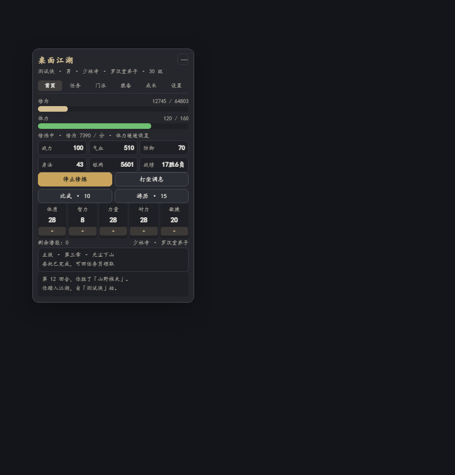
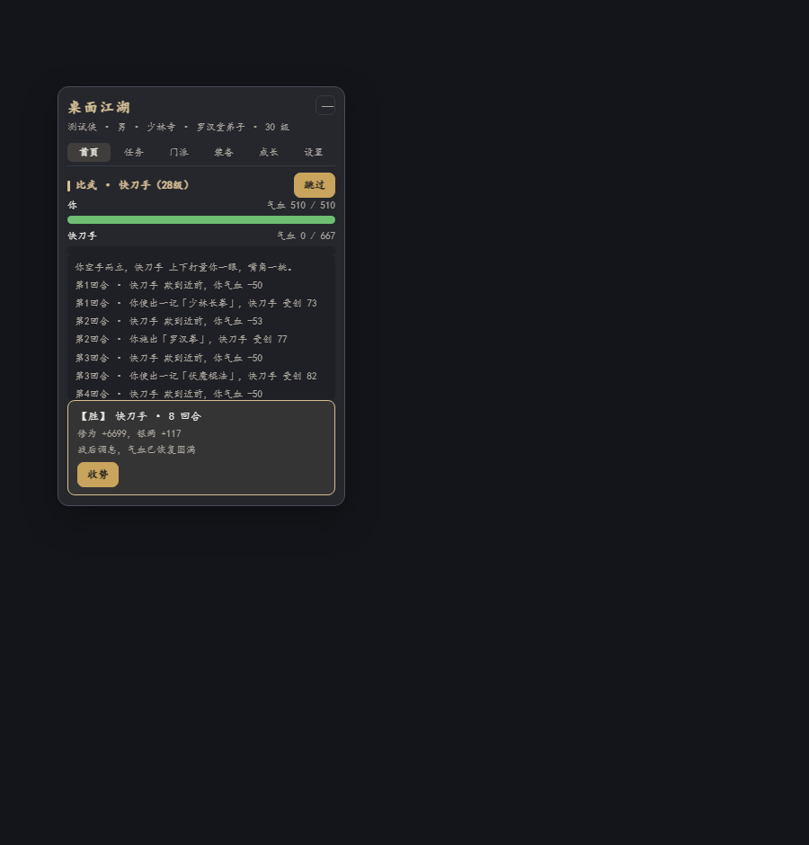
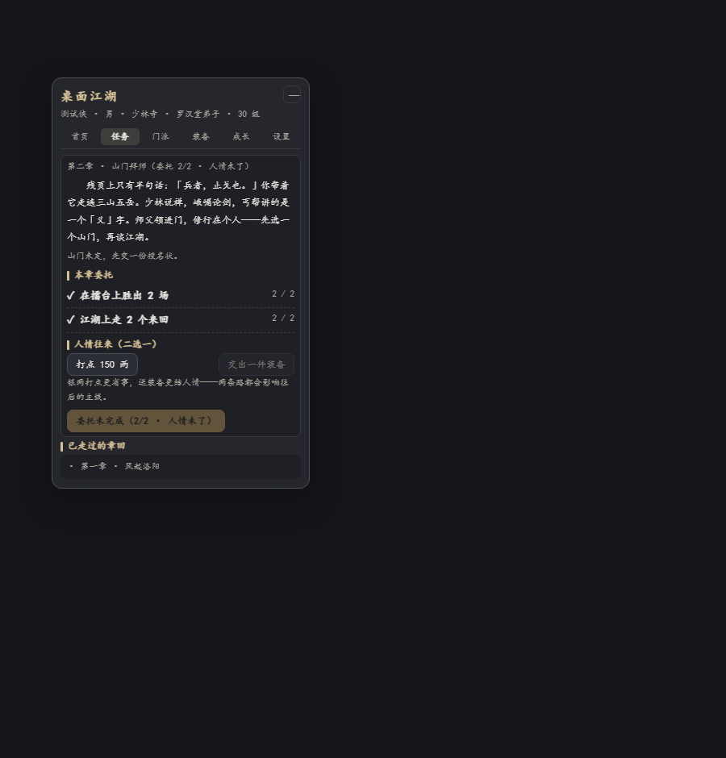
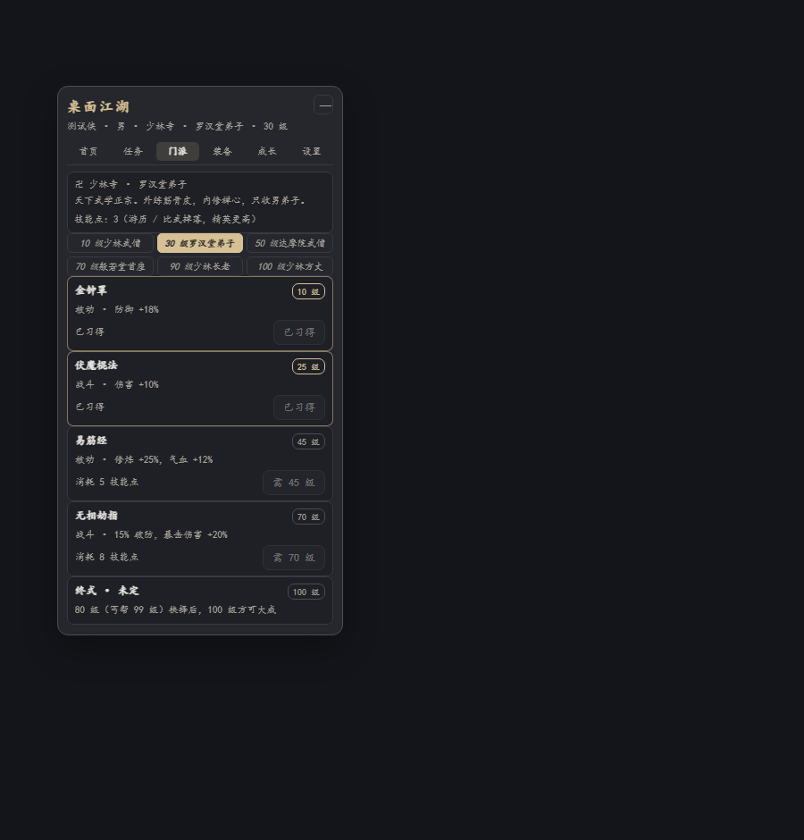
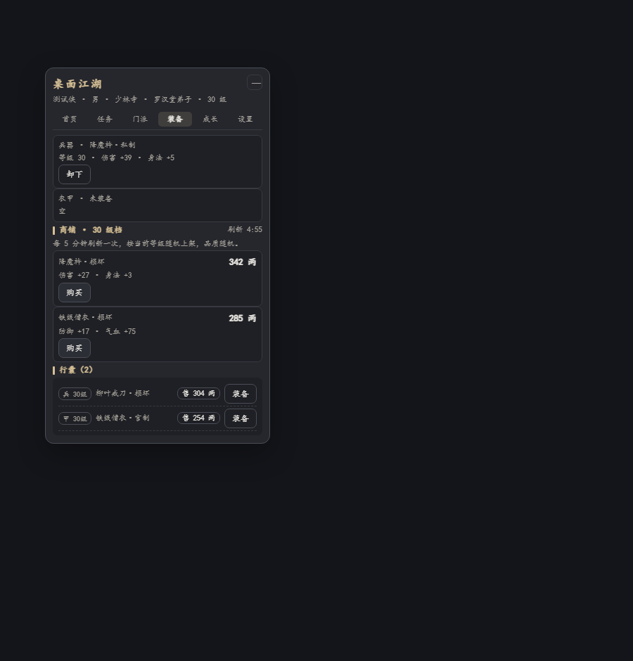
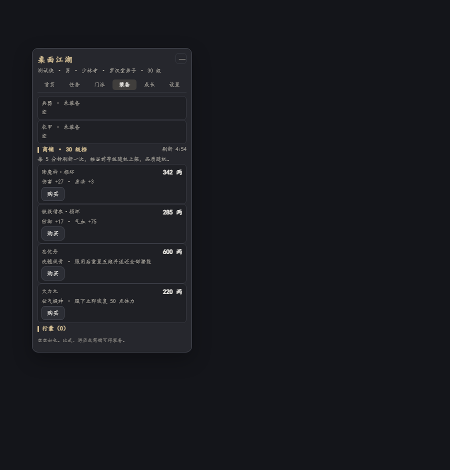
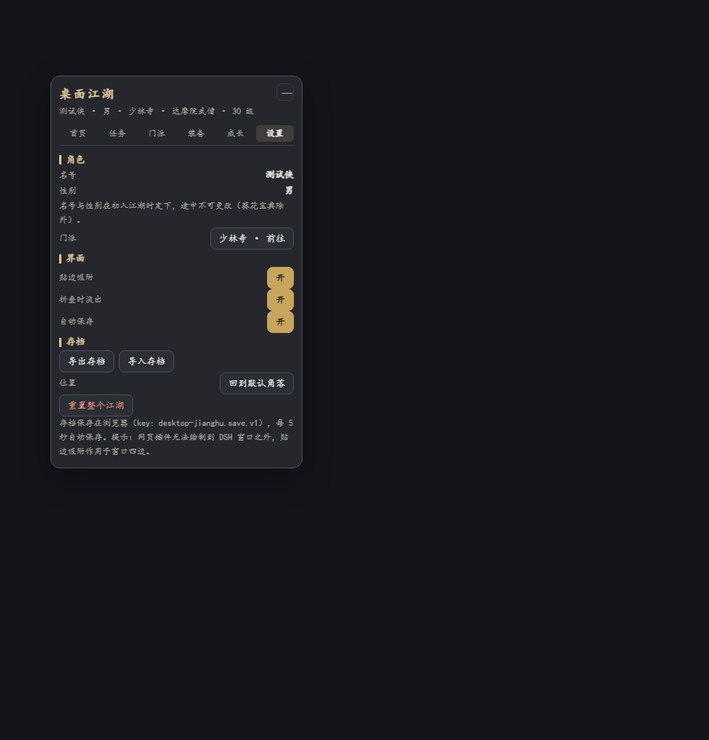
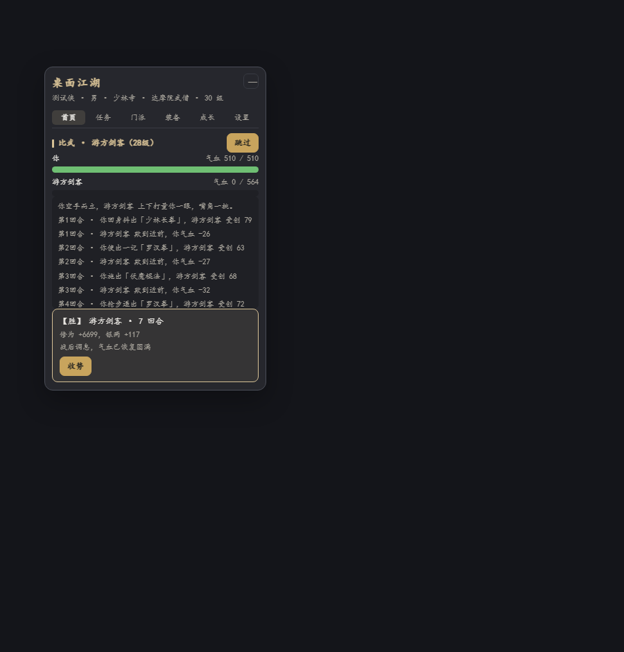
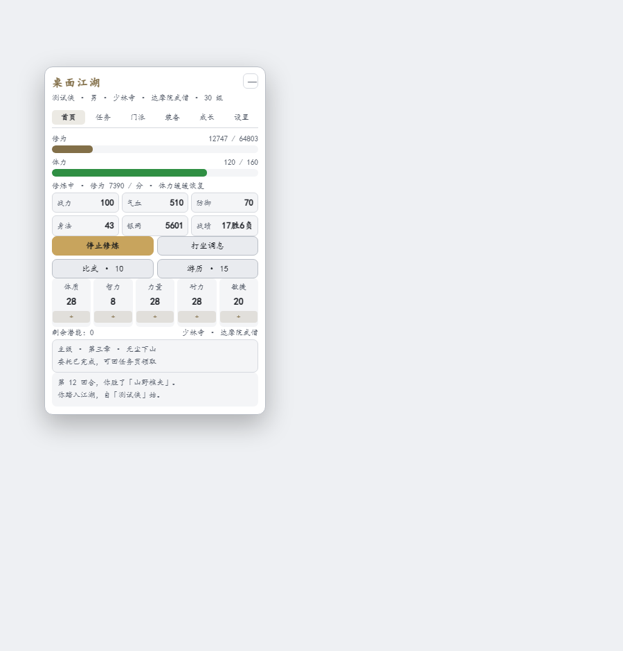
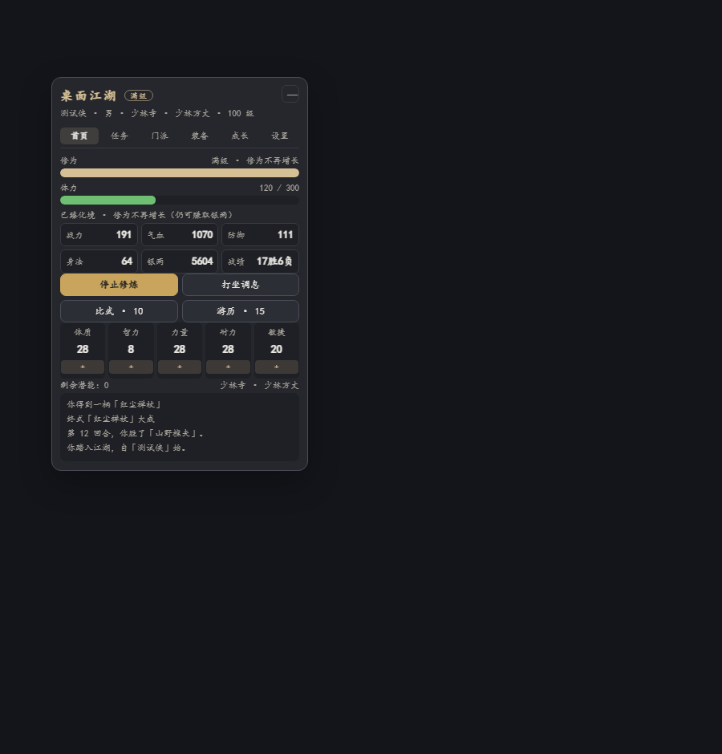

# 桌面江湖 · Desktop Jianghu

> 一个常驻在 [DeepSeek Harness](https://github.com/deepseek-ai) 桌面上的文字武侠小挂件：
> 挂机修炼、打坐调息、三选一比武、门派主线、江湖游历、装备与绝世神兵。
> 全部数据存在本地浏览器里，不联网、不调用模型、无付费点。

A persistent wuxia text-game widget for the DeepSeek Harness desktop — idle cultivation,
turn-based duels, sect storylines, quests, equipment and legendary weapons. Local-only,
no network, no model calls. Built as a Cordis client plugin (React + CSS, no bitmaps).



## 特性

- **挂机修炼 / 打坐调息**：修炼缓慢恢复体力并持续获得修为与银两；打坐快速回体力但不涨修为。离线结算上限 8 小时。
- **三选一比武**：每场可挑「初出茅庐 / 旗鼓相当 / 凶名在外」三名对手，带预估胜算、逐条战斗动画与真实气血快照；战斗日志会按你已学的武学与兵器出招。
- **门派系统**：少林寺（男）、峨嵋派（女）、丐帮（男女皆可），各有 5 式武学、6 阶称号与专属成长记录。
- **主线剧情**：贯穿 80 级，10 级拜师后按门派分支；少林 / 峨嵋 80 级二选一决定 100 级终式，丐帮另有 99 级隐藏支线。
- **等级与满级**：1–100 级硬上限；满级后修为不再增长（仍可赚银两），标题旁显示「满级」徽标。
- **江湖游历**：深山 / 湖泊 / 山寨 / 古道 / 市井 / 竹林六方向，随机事件、概率二段奇遇，可能获得银两、修为、装备与道具。
- **装备与商铺**：门派专属兵器衣甲，每 5 级一档，官制 / 私制 / 损坏三品级；商铺每 5 分钟随机刷新；行囊可出售；七把绝世神兵对应不同终局。
- **任务与人事**：每章有可执行的委托（比武、击败精英、游历方向、收集装备…），并需在「打点银两 / 交出一件装备」中二选一，影响后续主线口风与奖励。
- **桌面体验**：悬浮卡可自由拖动、贴边吸附、折叠成小胶囊；明暗主题跟随 DSH；本地存档、导出 / 导入、一键重置。

| 比武 | 任务 |
| --- | --- |
|  |  |

| 门派 | 装备 |
| --- | --- |
|  |  |

| 商城 | 设置 |
| --- | --- |
|  |  |

| 比武结果 | 浅色主题 |
| --- | --- |
|  |  |

## 安装

要求：DeepSeek Harness ≥ 已支持第三方 bundle 的版本（插件管理器 / plugin_manager）。

```bash
git clone https://github.com/0xfri/desktop-jianghu.git
```

然后在 DSH 中安装本地 bundle（把你的实际路径替换进去）：

```text
plugin_manager install_bundle  /path/to/desktop-jianghu
```

安装成功后刷新页面（F5 / Ctrl+R），右下角出现「桌面江湖」悬浮卡即加载成功。若仍未出现，
重启一次 DSH 让宿主重新加载客户端模块。

> `@local/` 前缀是开发期的本地 link 安装；本仓库改为可发布包名
> `dsh-desktop-jianghu`，安装入口为包根目录（含 `package.json` 与 `cordis.patch.yml`）。

## 使用

- **拖动 / 吸附**：按住标题栏拖动；松手时靠近窗口四边 24px 内会吸附。双击标题栏回到默认角落。
- **折叠**：标题栏右侧「—」收起为胶囊，单击展开；胶囊本身也可以拖动。
- **页签**：首页 / 任务 / 门派 / 装备 / 成长 / 设置。
- **加点**：点击「+」加一点；长按 420ms 后每 160ms 自动加点。
- **存档**：自动写入 `localStorage`（key：`desktop-jianghu.save.v1`），每 5 秒落盘；
  设置页可导出 / 导入 JSON。更早版本的旧存档会在首次读取时自动迁移。

## 数值与节奏

- 五维：体质 / 智力 / 力量 / 耐力 / 敏捷；每级 +3 潜能点。
- 修为曲线：`28 × 等级^2.25 + 70 × 等级^1.3`；比武胜利得对手经验的 12%，失败 3%。
- 体力：修炼模式 +1/分钟，打坐模式约 +6/分钟，闲置 +1/40 秒；比武 10 点、游历 15 点。
- 对手强度按「等级预期战力 × 玩家实际战力阻尼混合」自适应：满配普通约九成胜率，
  「凶名在外」约六成；不同 build 会有明显差异。
- **等级上限：100 级满级**。满级后修为不再增长（仍可赚银两），界面会显示「满级」标记；
  比武对手等级同步封顶 100。
- 主线 10 级拜师、20 级后逐步解锁；90 级后进入终局抉择。



## 技术边界（务必知晓）

DSH 桌面端是 Electron 应用，插件运行在 **Web 渲染层**，只能绘制在 DSH 窗口内部，
无法把像素画到应用窗口之外。因此：

- 「贴边吸附」吸附的是 **DSH 窗口的四边**，不是屏幕边缘；
- 悬浮卡不能拖动到 DSH 窗口以外；
- 若未来需要真正的桌面级小窗，需要原生伴随窗口方案（本仓库不包含）。

## 开发

```bash
npm ci             # 安装开发依赖（package-lock.json）
npm run build      # src/ → client.js
npm test           # jsdom 冒烟 70 项
npm run dev:preview  # 本地预览 http://localhost:5173/dev/preview.html
```

> 也可用 pnpm：仓库自带 `pnpm-workspace.yaml`（`nodeLinker: hoisted`，jsdom 的依赖需要平铺）。

仓库结构：

```
src/shell.js      宿主外壳（模块加载、通用工具、apply）
src/v3-data.js    静态数据（门派/称号/武学/任务/装备/事件）
src/v3-core.js    游戏逻辑与平衡
src/v3-ui.js      React UI（注册 shell.overlay 悬浮卡）
scripts/build.cjs 构建脚本（须生成唯一 __ModuleLoader__.load）
tests/smoke.cjs   UI 冒烟测试
dev/              预览页、静态服务器、平衡采样
docs/             README 截图
client.js         构建产物（请勿直接手改）
```

详细说明见 [dev/README.md](dev/README.md)。

## 兼容性

- 桌面端：DeepSeek Harness Web 渲染层（Electron），Chrome/Edge/Firefox 内核。
- 依赖：React 18（由 DSH 浏览器模块表提供）、`@deepseek-ai/dsh-client-ui-conversation`。
- 存储：`localStorage`，单机、离线可用；不采集任何数据。

## 开源协议与声明

- 代码以 [MIT License](LICENSE) 开源。
- 本项目是**非官方、非商业的同人作品**，与腾讯及《精武堂》、QQ 家园无任何关联；
  不含任何原作素材，玩法致敬 2009 年前后的手机文字武侠社区游戏。
- 游戏内门派、人物、剧情均为原创虚构，如有雷同纯属巧合。

## 发布状态（GitHub）

- [x] `package.json` 已填 `repository` / `homepage` / `bugs` / `author`（`0xfri`）。
- [x] 包名 `dsh-desktop-jianghu`（发布到 npm 前请确认该名称可用，或改成你的 scope）。
- [x] README 中的仓库地址已指向 `0xfri/desktop-jianghu`。
- [x] `npm test` 通过（70 项）、`npm run build` 产物已提交。
- [ ] 在 GitHub 创建仓库并推送（本机可 `git init && git add . && git commit`，仓库已含 `.gitignore`；
      或直接使用 `scripts/publish-repo.ps1`）。
